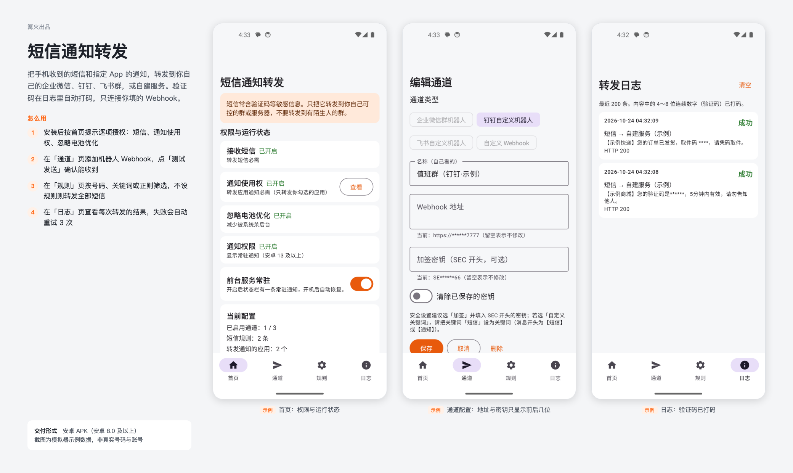

# 验证码 / 订单通知转发（短信通知转发）

> 篝火出品 · 收录于篝火 App 应用区。本工具开源，全部工具见 [toolkit-hub](https://github.com/campfire-code/toolkit-hub)。

把手机收到的短信，以及你勾选的 App 的通知，转发到你自己的企业微信群、钉钉群、飞书群或自建服务。原生安卓应用，不依赖任何云端，只连接你自己填的 Webhook 地址。



> 截图为模拟器里的示例数据，号码和账号都是虚构的。

> **请先看这一条**：短信里常有验证码、银行通知等敏感信息。只把它转发到你自己可控的群或服务器，不要转发到有陌生人的群。

## 能做什么

- 接收短信并按规则过滤：发件号码包含、内容关键词包含、正则（可选）。可以建多条规则，命中任意一条就转发；没有规则则转发全部短信。
- 可选：转发指定 App 的通知（在应用列表里勾选）。
- 四种转发通道，可同时启用多个，各自有开关：企业微信群机器人、钉钉自定义机器人（支持「加签」）、飞书自定义机器人（支持「签名校验」）、自定义 Webhook。
- 每个通道有「测试发送」按钮。发送失败自动重试，一共最多发送 3 次（首次加 2 次重试，间隔 10 秒起、逐次翻倍），由 WorkManager 调度。
- 转发日志：最近 200 条，显示时间、来源、通道、结果。日志和界面里的验证码（4～8 位连续数字）一律打码；Webhook 地址和密钥只显示前后几位。
- 常驻与开机自启：首页显示各项权限状态并可一键跳转系统设置；可选前台服务常驻；开机后自动恢复。

不做：远程控制、来电转发、短信回复、云端同步、统计上报。

## 下载安装

1. 打开本仓库的 [Releases](https://github.com/campfire-code/sms-notify-forwarder/releases)，下载最新的 `sms-notify-forwarder_<版本>_android.apk`。`SHA256SUMS.txt` 是校验值，可用来核对文件。
2. 在手机上点开 APK 安装。系统提示不允许安装未知来源应用时，按提示在设置里允许当前浏览器或文件管理器安装。
3. 要求安卓 8.0（API 26）及以上。

## 首次设置

打开应用，首页「权限与运行状态」里逐项处理：

1. **接收短信**：点「授权」，在系统弹窗里允许。如果之前点过拒绝、弹窗不再出现，点下面的「到应用详情页手动开启」，在「权限」里打开短信。
2. **通知使用权**（只在转发 App 通知时需要）：点「去开启」，在系统列表里找到「短信通知转发」并打开。
3. **忽略电池优化**：点「去设置」，在系统弹窗里选允许。部分系统会改为打开一个应用列表，在列表中把本应用设为「不优化」。
4. **通知权限**（安卓 13 及以上）：点「授权」。用于显示前台服务的常驻通知。
5. 想让它在后台更稳定，打开「前台服务常驻」。开启后状态栏会有一条常驻通知，重启手机后自动恢复。

各品牌手机的后台常驻限制不同。通用做法：除了上面的「忽略电池优化」，再到系统设置里找「自启动」「后台运行」「应用锁定 / 加入白名单」之类的选项，允许本应用自启动和后台运行；从多任务界面清理应用时，不要把本应用划掉。具体菜单名称和路径因品牌、系统版本而异，请以你手机上的设置为准。

> 安卓 13 及以上，通过 APK 手动安装的应用，系统可能把短信权限和通知使用权列为「受限设置」，需要先在「设置 → 应用 → 短信通知转发」右上角菜单里选「允许受限设置」，再去授权。这是系统机制，本工具没有在真机上验证过，请以你手机的实际表现为准。

## 配置转发通道

在「通道」页点「添加通道」，选类型、填名称和 Webhook 地址，保存后点「测试发送」。以下按各平台官方文档整理。

### 企业微信群机器人

1. 在企业微信群里添加「群机器人」，复制它的 Webhook 地址，形如 `https://qyapi.weixin.qq.com/cgi-bin/webhook/send?key=…`。
2. 本应用以 POST 发送 `{"msgtype":"text","text":{"content":"…"}}`。文本内容上限 2048 字节，超出会截断；每个机器人每分钟最多 20 条。
3. 地址等同于密码，泄露后别人可以往你的群里发消息。

### 钉钉自定义机器人

1. 在钉钉群里添加「自定义机器人」。安全设置建议选「加签」，把以 `SEC` 开头的密钥填到本应用的「加签密钥」里。
2. 加签时本应用在 Webhook 地址后追加 `timestamp`（毫秒）和 `sign` 两个参数。`sign` 的算法：待签名字符串为 `timestamp + "\n" + 密钥`，以密钥为 key 做 HmacSHA256，再 Base64，再 URL 编码。
3. 如果只能选「自定义关键词」，请同时添加「短信」「通知」两个关键词（本应用发出的消息，短信含「短信」、通知含「通知」）。
4. 消息体为 `{"msgtype":"text","text":{"content":"…"}}`，以返回的 `errcode` 是否为 0 判断成功。

### 飞书自定义机器人

1. 在飞书群里添加「自定义机器人」，复制 Webhook 地址，形如 `https://open.feishu.cn/open-apis/bot/v2/hook/…`。
2. 安全设置若勾选「签名校验」，把密钥填到本应用里。此时请求体里会多出 `timestamp`（秒）和 `sign`。`sign` 的算法：以 `timestamp + "\n" + 密钥` 为 key、以空内容为消息做 HmacSHA256，再 Base64。
3. 若用「自定义关键词」，同样请同时添加「短信」「通知」两个关键词。
4. 消息体为 `{"msg_type":"text","content":{"text":"…"}}`，以返回的 `code` 是否为 0 判断成功。

### 自定义 Webhook

向你填的地址 POST `application/json`，字段固定为：

| 字段 | 含义 |
|---|---|
| `from` | 短信发件号码；通知为通知标题 |
| `content` | 短信正文；通知为通知正文 |
| `receivedAt` | 手机收到的时间，ISO-8601 带时区，如 `2026-10-24T20:00:00+08:00` |
| `source` | `sms` 或 `notification` |
| `app` | 通知来源的应用名；短信为空字符串 |

返回任意 2xx 即视为成功。示例见 `samples/custom-webhook-body.json`。

> 本应用允许明文 HTTP 地址，方便指向局域网或本机服务；企业微信、钉钉、飞书的官方地址都是 HTTPS。公网上的自建服务请使用 HTTPS。

### 核实过的官方文档

- 企业微信群机器人配置说明：<https://developer.work.weixin.qq.com/document/path/91770>（Webhook 格式、`msgtype=text`、`text.content` 2048 字节、每分钟 20 条）
- 飞书自定义机器人：<https://open.feishu.cn/document/client-docs/bot-v3/add-custom-bot>（`msg_type`/`content.text`、签名校验算法、`timestamp` 为秒且与当前时间相差不超过 1 小时、返回 `code`）
- 钉钉自定义机器人：<https://open.dingtalk.com/document/robots/custom-robot-access> 与 <https://open.dingtalk.com/document/robots/customize-robot-security-settings>。**这两个页面是前端渲染，抓取工具取不到正文**，加签算法按钉钉企业内部机器人文档中同样的「timestamp + 换行 + 密钥、HmacSHA256、Base64」规则（<https://open.dingtalk.com/document/isvapp/enterprise-created-chatbot>）和多份引用官方文档的资料实现，`timestamp` 为毫秒、`sign` 需 URL 编码，没有逐字对照官方原文。上线前请用真实钉钉机器人联调一次。

官方文档没有给出钉钉、飞书签名的示例结果值，单元测试里的期望值由独立实现（Python 的 `hmac`、`hashlib`、`base64`、`urllib`）按同一算法算出。

## 隐私说明

- 应用只向你自己配置的 Webhook 地址发请求，不连接任何其他服务器，没有统计、没有上报、没有云端同步。
- 配置（含 Webhook 地址和密钥）保存在应用私有目录里，已关闭系统备份。
- 转发日志只保存打码后的内容摘要，数据库里没有原始验证码。注意：发到你的机器人或服务器的消息是**原文**，打码只作用于本机日志和界面。
- 通知转发只处理你勾选的应用；应用列表通过「桌面应用查询」得到，没有申请「查看所有应用」权限。

## 验收用例

在电脑上起接收服务，在模拟器里验证（真机把 `10.0.2.2` 换成电脑的局域网 IP）：

```bash
python3 samples/receiver.py 8765          # 终端 1：本地接收服务
adb emu sms send 106900 "【示例商城】您的验证码是582913，5分钟内有效"   # 终端 2：模拟收到短信
```

1. 在「通道」页添加「自定义 Webhook」，地址填 `http://10.0.2.2:8765/hook`，点「测试发送」。预期：终端 1 打印一条 JSON，`content` 为测试文字，`source` 为 `sms`；日志页出现「测试 → 通道名 成功」，内容里的 `123456` 显示为 `******`。
2. 发上面的 `adb emu sms send`。预期：终端 1 收到 `{"from":"106900","content":"【示例商城】您的验证码是582913，…","receivedAt":"…","source":"sms","app":""}`；日志页显示验证码被打码。
3. 在「规则」页添加一条「内容关键词包含 ORDER」。发 `adb emu sms send 10010 hello`：不转发；发 `adb emu sms send 10010 ORDER-1`：转发。
4. 关掉接收服务后再发一条短信：日志先显示「重试中」，重新起服务后在下一次重试时变为「成功」（第 2 次成功）。
5. 打开「前台服务常驻」后重启模拟器：重启后状态栏出现常驻通知，服务在运行。
6. 在「规则」页勾选一个会发通知的应用（如模拟器里的 Messages），并开启通知使用权。收到短信时该应用弹出的通知也会被转发，`source` 为 `notification`，`app` 为应用名。

更多示例短信见 `samples/sms-examples.txt`。

## 已知限制

- 只转发普通短信（`SMS_RECEIVED` 广播）。彩信、运营商的 RCS 富媒体消息不一定走这个广播，按安卓机制推断可能转发不到，未实测。
- 部分手机系统对后台应用管得很严，可能杀掉应用而漏转。按「首次设置」处理后仍漏转，请到系统的后台管理里把本应用加入白名单。
- 通知转发依赖系统的通知使用权，且只能读到应用发出的通知文字；应用不发文字、只发图片的通知会被忽略。同一应用 10 秒内完全相同的通知只转一次。
- 重试靠 WorkManager 调度，间隔受系统省电策略影响，可能比 10 秒更晚。
- 短信时间使用手机收到的时间，而不是运营商短信里的时间戳（模拟器里后者会偏一个小时，真机未对比）。
- 钉钉签名未逐字对照官方原文，见上文「核实过的官方文档」。
- 企业微信、钉钉、飞书的真实账号联调列入待联调清单：本机只用本地服务验证过自定义 Webhook，三个机器人的请求格式靠单元测试和官方文档保证。

## 构建

需要 JDK 17 和 Android SDK（compileSdk 35）。

```bash
./gradlew testDebugUnitTest   # 单元测试
./gradlew assembleDebug       # 调试包：app/build/outputs/apk/debug/
./gradlew lint
```

release 包的签名从环境变量读取：`ANDROID_KEYSTORE_FILE`、`ANDROID_KEYSTORE_PASSWORD`、`ANDROID_KEY_ALIAS`、`ANDROID_KEY_PASSWORD`。没有这些变量时 release 不签名。仓库里没有任何密钥文件。打 `v0.1.0` 这样的标签会触发 GitHub Actions 出包。

## 许可证

MIT，见 [LICENSE](LICENSE)。第三方依赖见 [THIRD_PARTY_LICENSES.md](THIRD_PARTY_LICENSES.md)。本工具从零自研，没有参考或复制其他同类项目的源码、资源或界面文案。
